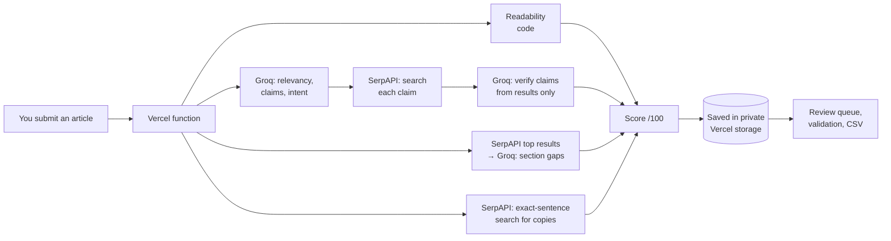

# AI Content Quality Auditor

A web app on Vercel (React, Tailwind CSS, shadcn/ui) that scores articles out of 100 for accuracy, readability, keywords, missing sections and plagiarism. Every audit is saved, low scores go to a human review queue, and a validation page compares the auditor with your own scores on 30 test articles. The AI checks run on [Groq](https://groq.com).

Everything runs inside the Vercel project: there is no n8n or other server to set up.



## Scoring (100 points)

| Parameter | Points | How it is checked |
|---|---|---|
| **Accuracy and relevancy** | 30 | Heading ↔ content match, 0–10 per H2/H3, averaged (10). Factual claims pulled out by the AI, each searched on Google via SerpAPI, then judged **only from those search results** (12). Time-sensitive statements (5). Does the article deliver what the title promises (3). |
| **Readability** | 20 | Hemingway-style, computed in code: ARI grade vs the target (8), share of hard/very hard sentences (6), passive voice (3), adverbs per 100 words (3). The target grade is the median grade of the top-ranking pages (kept between 6 and 12), the way Semrush sets its readability target from the top 10; grade 9 if fewer than 3 pages can be read. A grade picked on the New audit form overrides it. |
| **Keywords** | 20 | Primary keyword in title, H1, first 100 words and meta description (6). Density 0.5–2.5% (2; over 3.5% counts as stuffing). Your secondary keywords plus up to 10 related terms, each checked in the text by code (8). Search intent match (4). Related terms outweigh exact repeats, as in Ahrefs' topic-based scoring. |
| **Missing sections** | 20 | Headings of the top-ranking pages are compared with yours; subtopics that appear on at least 3 of them must be covered (14). Intro, conclusion, FAQ, 3+ H2s (4). Not thin (2): Google says it has no preferred word count, so length only loses points below half the top pages' median. |
| **Plagiarism** | 10 | **Free Google phrase check** (uses your SerpAPI key): 3 distinctive sentences from the article are searched on Google in quotes. None found on other sites = 10, one = 5, two or more = 0 and sent to review. It catches copied passages, not reworded ones. Optional upgrade: if Copyscape keys are added, a full Copyscape comparison is used instead (0–5% match = 10, 5–10% = 6, 10–15% = 2, over 15% = 0). |

**An article goes to the review queue** when the total is below the pass mark (70 by default), a claim is contradicted by a search result, plagiarism is over 15%, or a check couldn't run (a missing key, a rate limit, a blocked site). A check that didn't run never counts as a pass. If the main AI step fails, the audit is marked **Failed**: it still shows what was checked, but it doesn't count in validation.

### How this compares with Google, Semrush and Ahrefs

- **Google** publishes no score. Its people-first content guidance asks about sourcing, expertise and easily verified factual errors (the fact check here), says it has no preferred word count (so length only penalises thin pages), and treats content made mainly for search traffic as a warning sign.
- **Semrush SEO Writing Assistant** sets its readability target from the top 10 Google results (done here too) and recommends related keywords that are common in top-ranking pages.
- **Ahrefs AI Content Helper** scores how well the topics shared by top-ranking pages are covered, and says keyword stuffing doesn't help (hence topic coverage at 14 points and density at 2).
- None of them fact-checks claims; Ahrefs' own study found only weak correlation between content scores and rankings, so treat the total as a quality checklist, not a ranking prediction.

### How hallucination is kept out

- The AI never decides whether a related term is present; code searches the text.
- A claim is only marked **verified** or **false** if the AI points to one of the search results it was given. Any other verdict, or a made-up URL, is downgraded to **unverified**.
- Every number the AI returns is clamped to its range, and missing answers score as missing, not as full marks.
- Readability, keyword placement, density, structure, length and plagiarism bands involve no AI at all.

### About Hemingway

Hemingway Editor has no public API. Readability rebuilds its approach instead: the Automated Readability Index for the grade (Hemingway's default target is grade 9), plus sentence-level hard/very-hard flags, passive voice and adverbs. The thresholds are this project's own and are meant to be tuned during validation; compare with Hemingway when you score the 30 test articles.

## Setup

Everything is set in Vercel: **Project → Settings → Environment Variables**. After adding or changing a variable, **redeploy** (Deployments → ⋯ on the latest → Redeploy).

### 1. Storage (already done)

Audits are saved in a private Vercel Blob store connected to the project. It is created and connected for you; it shows under the project's **Storage** tab, and Vercel adds `BLOB_READ_WRITE_TOKEN` automatically. To check it, open `/api/health?check=storage` on your site: `"storage_check": "ok"` means it works.

### 2. Keys

| Variable | Needed? | Where to get it |
|---|---|---|
| `GROQ_API_KEY` | **Required** | [console.groq.com/keys](https://console.groq.com/keys) → Create API Key (starts with `gsk_`) |
| `SERPAPI_KEY` | Recommended | [serpapi.com/manage-api-key](https://serpapi.com/manage-api-key) (free plan available). Powers fact-checking, missing sections and the free plagiarism check. |
| `COPYSCAPE_USERNAME`, `COPYSCAPE_API_KEY` | Optional, paid | Only if you want Copyscape's full plagiarism comparison instead of the free phrase check. |
| `APP_PASSWORD` | Optional | Any password. If set, people must type it to use the app. If not set, anyone with the link can run audits on your API credits. |

The top right of the site shows **Ready** when the Groq key and storage are in place, and a banner lists anything still missing.

### 3. Optional tuning

| Variable | Default | What it does |
|---|---|---|
| `PASS_MARK` | `70` | Totals below this go to review |
| `GROQ_MODEL` | `openai/gpt-oss-120b` | Any Groq chat model ID from [console.groq.com/docs/models](https://console.groq.com/docs/models) |
| `GROQ_REASONING_EFFORT` | `low` | For `openai/gpt-oss-*` models: `low`, `medium` or `high` |
| `MAX_PROMPT_CHARS` | `14000` | Most article text sent to the AI in one request |
| `LLM_PAUSE_SECONDS` | `15` | Pause between AI calls, to stay inside Groq's per-minute limit |
| `COMPETITOR_PAGES` | `6` | Top-ranking pages compared for missing sections (max 10) |
| `MAX_CLAIM_SEARCHES` | `5` | Most claims fact-checked per audit (each uses one SerpAPI search) |
| `PLAGIARISM_PHRASES` | `3` | Sentences searched for the free plagiarism check (0 turns it off) |
| `MOCK_MODE` | – | `1` shows built-in sample data and calls no outside service |

## Limits to know

**Vercel (free Hobby plan).** One audit must finish within 5 minutes; the app stops itself at about 4½ minutes and saves what it has. Blob storage includes 2,000 writes and 10,000 reads a month for free; an audit uses 2 writes, and each review or validation save uses 1. If the free limits are exceeded, Vercel pauses Blob storage until the month resets (it emails before that happens).

**Groq.** Groq's docs list these limits for `openai/gpt-oss-120b`: 30 requests a minute, 1,000 a day, 8,000 tokens a minute and 200,000 tokens a day; your exact numbers are at [console.groq.com/settings/limits](https://console.groq.com/settings/limits). One audit uses roughly 10,000–15,000 tokens, so expect on the order of 15 audits a day on the free plan. The app keeps each request small, pauses between calls, waits and retries when Groq says "rate limit", and if it still fails, the report says so. For the 30 validation articles, spread them over two days or use a paid Groq plan (then raise `MAX_PROMPT_CHARS` and set `LLM_PAUSE_SECONDS` to 1).

**SerpAPI.** The free plan is small: third-party pricing pages list about 250 searches a month and 50 an hour (one says 100 a month); your SerpAPI dashboard shows your real allowance. One audit uses at most 9 searches (up to 5 claims, 1 for top results, 3 for the plagiarism check), so roughly 25 audits a month on 250 searches. Lower `MAX_CLAIM_SEARCHES` or `PLAGIARISM_PHRASES` to stretch it.

**Sites that block bots** (or need JavaScript to show text) can't be fetched; paste the content instead.

## Results in Google Sheets

Every audit is saved in the app. **Download CSV** (on the home page) exports all audits with their scores, review decisions and your validation scores. In Google Sheets: File → Import → Upload the file.

## Validation against your own scores (30 articles)

1. Run each test article through the app.
2. On each report, before reading it closely, fill in **My scores** at the bottom using the same rubric.
3. Open **Validation** (on the Review page): average gap, correlation, pass/fail agreement and bias, overall and per parameter.
4. Any parameter with an average gap over 3 points is highlighted. Adjust that part (prompts in `src/llm.js`, thresholds in `src/readability.js` or `src/keywords.js`, bands in `src/scoring.js`), run `npm run generate`, push, and re-run the articles.

Targets shown in the app: an average total gap within 5 points, and pass/fail agreement on at least 27 of 30. These are goals to test against, not results.

## What's in the repo

```
web/                    Front end: React + Tailwind CSS + shadcn/ui-style components (Radix), Recharts
  src/pages/              Audits, New audit, Report, Review queue, Validation
  src/components/         UI primitives, charts, layout
api/                    Vercel functions
  audit.js                starts an audit, runs it in the background (up to 5 min)
  data.js                 list, report, review queue, validation
  export.js               CSV download
  health.js               setup status, ?check=storage
  _engine.js              generated from src/ (don't edit)
  _store.js               private Blob storage, sample data in mock mode
src/                    Scoring and pipeline code
  pipeline.js             the audit, step by step
scripts/                engine and sample-data generators, local server
tests/                  unit tests + full simulated audits (rate limits, missing keys, blocked sites, time limit)
```

Vercel runs `npm run build` (Vite) and serves `dist/`; every page path falls back to the app, and `/api/*` goes to the functions.

## Local development

```bash
npm install
npm run build && MOCK_MODE=1 npm run preview   # http://localhost:3000 with sample data
# or, for live editing:
MOCK_MODE=1 npm run dev:api                    # API on :3000
npm run dev                                    # Vite on :5173, proxies /api
npm test                                       # tests
npm run generate                               # rebuild api/_engine.js and sample data after editing src/
npm run check                                  # tests + generated files match src/ + production build
```

## Troubleshooting

| What you see | Likely cause |
|---|---|
| Report says SerpAPI "run out of searches" | Your SerpAPI monthly allowance is used up. Wait for the reset, upgrade, or lower `MAX_CLAIM_SEARCHES` / `PLAGIARISM_PHRASES`. |
| "Setup needed" at the top right | `GROQ_API_KEY` missing, or storage not connected. Add it, then redeploy. |
| Report says "GROQ_API_KEY is not set" | The key was added but the site wasn't redeployed, or the name has a typo. |
| "Groq rate limit reached (429)" | You hit Groq's per-minute or daily limit. Wait and run it again, raise `LLM_PAUSE_SECONDS`, or check usage at console.groq.com. |
| "Groq rejected the API key (401)" | Wrong or revoked key. Create a new one and replace `GROQ_API_KEY`. |
| "Couldn't fetch …" | The site blocks automated requests. Paste the content instead. |
| "No result after 6 minutes" | Something crashed before saving. Check the project's **Logs** in Vercel. |
| "Storage is not connected" | The Blob store was disconnected. Project → Storage → connect it, then redeploy. |
